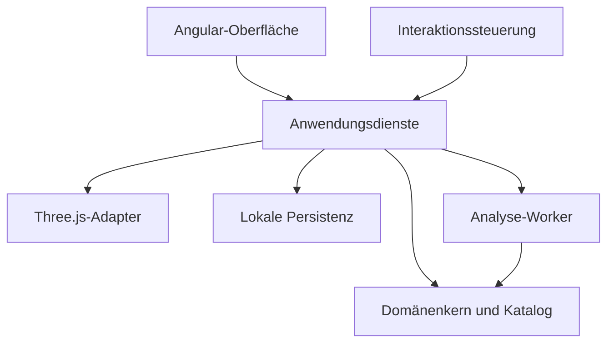

# Webbasierter Klemmbaustein-Editor

## Produkt- und Umsetzungskonzept

**Version:** 1.0  
**Stand:** 8. November 2026  
**Zielgruppe:** Softwareentwickler, implementierende Coding-Agenten, UX-Designer und Qualitätssicherung  
**Status:** Verbindliche Entwicklungsgrundlage für die erste produktiv nutzbare Version

Dieses Dokument beschreibt einen eigenständigen, frei nutzbaren Konstruktionseditor für digitale Klemmbausteinmodelle. Es enthält den vollständigen fachlichen Ausgangspunkt. Zur Umsetzung sind weder frühere Gespräche noch Referenzprojekte erforderlich.

„Frei“ bedeutet hier: frei gestaltbare Modelle, keine Bindung an ein bestimmtes Bauvorhaben und Nutzung der Kernfunktionen ohne Konto oder Bezahlung. Eine Open-Source-Lizenz oder ein Hostinganbieter wird dadurch nicht festgelegt.

Die erste Version ist eine browserbasierte Einzelplatzanwendung mit lokaler Speicherung. Anwender können aus einem allgemeinen Teilekatalog eigene Konstruktionen aufbauen, bearbeiten, auf geometrische Fehler und problematische Verbindungen untersuchen und eine nachvollziehbare Materialliste exportieren.

---

## Inhaltsverzeichnis

1. [Ziel und Qualitätsanspruch](#1-ziel-und-qualitätsanspruch)
2. [Verbindlicher Umfang](#2-verbindlicher-umfang)
3. [Produktoberfläche](#3-produktoberfläche)
4. [Interaktion und Bediengefühl](#4-interaktion-und-bediengefühl)
5. [Kamera und räumliche Orientierung](#5-kamera-und-räumliche-orientierung)
6. [Koordinaten, Raster und Maße](#6-koordinaten-raster-und-maße)
7. [Teilekatalog und Geometrie](#7-teilekatalog-und-geometrie)
8. [Platzierung und Einrasten](#8-platzierung-und-einrasten)
9. [Verbindungen und Stabilitätshinweise](#9-verbindungen-und-stabilitätshinweise)
10. [Auswahl, Gruppen und Bauabschnitte](#10-auswahl-gruppen-und-bauabschnitte)
11. [Architektur und Technologie](#11-architektur-und-technologie)
12. [Domänenmodell und Schnittstellen](#12-domänenmodell-und-schnittstellen)
13. [Befehle, Transaktionen und Undo/Redo](#13-befehle-transaktionen-und-undoredo)
14. [Rendering und Performance](#14-rendering-und-performance)
15. [Speicherung, Import und Export](#15-speicherung-import-und-export)
16. [Materialliste](#16-materialliste)
17. [Zugänglichkeit und Eingabegeräte](#17-zugänglichkeit-und-eingabegeräte)
18. [Tests und messbare Abnahme](#18-tests-und-messbare-abnahme)
19. [Umsetzungsreihenfolge](#19-umsetzungsreihenfolge)
20. [Arbeitsauftrag an den implementierenden Agenten](#20-arbeitsauftrag-an-den-implementierenden-agenten)
21. [Entscheidungsprotokoll und Risiken](#21-entscheidungsprotokoll-und-risiken)
22. [Technische Quellen](#22-technische-quellen)

---

## 1. Ziel und Qualitätsanspruch

### 1.1 Produktziel

Der Editor soll sich wie ein präzises Konstruktionswerkzeug anfühlen: direkt, vorhersehbar, reaktionsschnell und jederzeit korrigierbar. Ein Benutzer soll wenige Minuten nach dem Öffnen sicher Teile platzieren können und zugleich größere Modelle mit tausenden Teilen kontrolliert bearbeiten können.

Die Anwendung arbeitet mit einem echten dreidimensionalen Baumodell. Die isometrische Darstellung ist eine Kameraansicht dieses Modells. Die Anwendung ist kein Zeichenprogramm, das perspektivisch aussehende Formen auf einer Fläche anordnet.

### 1.2 Leitprinzipien

| Prinzip | Verbindliche Konsequenz |
|---|---|
| Vorhersehbarkeit | Ein Teil landet an der angekündigten Position. Die Vorschau darf beim Bestätigen nicht umspringen. |
| Präzision | Platzierungen und Verbindungen werden auf einem ganzzahligen Konstruktionsraster berechnet. |
| Kontrolle | Keine automatische Änderung vorhandener Teile, kein automatisches Fallen oder Umorganisieren. |
| Reversibilität | Jede Modelländerung besitzt eine vollständige Undo-Operation. |
| Sichtbarkeit | Werkzeug, Bauhöhe, Rotation, Auswahl und Platzierungsstatus sind erkennbar. |
| Fachliche Ehrlichkeit | „Verbunden“, „aufliegend“ und „möglicherweise schwach verbunden“ sind unterschiedliche Aussagen. |
| Kontinuität | Kamerabewegung, Fensterwechsel und Autosave unterbrechen keine Konstruktion unbemerkt. |
| Unabhängigkeit | Das Baumodell lässt sich ohne Angular, Three.js und Browser testen. |

### 1.3 Keine zugesicherte Tragfähigkeit

Der Editor unterstützt konstruktiv sinnvolle Modelle durch Verbindungsanalysen und nachvollziehbare Hinweise. Er simuliert in Version 1 weder Klemmkräfte noch Materialverformungen oder reale Lasten. Eine digitale Verbindung oder ein unauffälliger Prüfbericht ist keine Zusicherung physischer Belastbarkeit.

Im Produkt genügt ein knapper Hinweis im Prüfbereich. Es soll keine wiederkehrenden Warnmodalitäten beim normalen Bauen geben.

---

## 2. Verbindlicher Umfang

### 2.1 Release 1: verpflichtend

| Bereich | Lieferumfang |
|---|---|
| Projekte | Neues leeres Projekt, lokale Projektübersicht, Umbenennen, Kopieren, Löschen mit Wiederherstellung |
| Teile | Grundsteine, Platten, Fliesen, Bauplatten, Fenster- und Türbaugruppen |
| Bauen | Platzieren, wiederholt setzen, Drehen in 90°-Schritten, Verschieben, Duplizieren, Löschen, Umfärben |
| Auswahl | Einzel- und Mehrfachauswahl, Rechteckauswahl, „verbundene Teile auswählen“ |
| Ansichten | Vier isometrische Richtungen, Draufsicht, Seitenansichten und freie Kamerainspektion |
| Bearbeitung | Undo/Redo, numerische Position, gezielte Bauhöhe, Bauabschnitte, Gruppen |
| Prüfungen | Kollisionen, Rasterkonformität, Steckverbindungen, getrennte Komponenten, ausgewählte Schwachstellen |
| Speicherung | Autosave in IndexedDB, Wiederherstellung, JSON-Import/-Export, Offline-Betrieb nach erster vollständiger Bereitstellung |
| Ausgaben | Materialliste nach Teil und Farbe, CSV-Export, PNG der aktuellen Ansicht |
| Bedienung | Maus/Tastatur vollständig; Tablet mit Touch für Platzieren, Auswählen und Navigation |

Alle genannten Funktionen gehören zum fertigen Release. Die später beschriebenen Meilensteine sind eine Reihenfolge der Implementierung und keine stillschweigende Reduktion des Lieferumfangs.

### 2.2 Bewusste Grenzen von Release 1

- Teile bleiben aufrecht; ihre Modellrotation erfolgt ausschließlich um die Hochachse in 90°-Schritten.
- Vertikale Standard-Steckverbindungen sind unterstützt. Seitliche Noppen, Gelenke, Achsen, Clips, flexible Elemente und frei geneigte Bauteile folgen später.
- Fenster und Türen sind zunächst starre, definierte Baugruppen. Türschwenkmechanik ist nicht Teil des Editors.
- Kein Mehrbenutzerbetrieb, kein Backend, keine Benutzerkonten, keine Lieferantenintegration.
- Kein automatischer Gebäudegenerator, keine KI-Platzierung, keine Fotorekonstruktion.
- Kein physikalisches Auseinanderfallen, keine Kraftberechnung, keine automatisch erzeugte Montageanleitung.
- Keine beliebigen importierten 3D-Geometrien oder ausführbaren Katalogskripte.
- Smartphone: Projektansicht, Materialliste und Export. Vollständige Touch-Bearbeitung wird ab 768 CSS-Pixeln Breite unterstützt.

### 2.3 Fachliche Freiheit

Es gibt keine festen Gebäudekategorien, Geschosszahlen oder vorgeschriebenen Grundrisse. Die Arbeitsfläche ist ein verschiebbares Raster. Ein optional angezeigtes Bauflächenrechteck ist eine Orientierungshilfe und kein unsichtbares Hindernis.

Technische Projektgrenzen sind transparent: Release 1 zielt auf 10.000 physische Teile. Über diese Grenze hinaus öffnet die Anwendung ein Projekt zunächst lesend und ermöglicht Export oder eine ausdrücklich angeforderte Fortsetzung ohne Performancezusage. Ein Import wird nie heimlich gekürzt.

---

## 3. Produktoberfläche

### 3.1 Aufbau auf dem Desktop

Der 3D-Arbeitsbereich nimmt den größten Teil des Fensters ein. Die Oberfläche besitzt fünf klar getrennte Bereiche:

| Bereich | Inhalt | Verhalten |
|---|---|---|
| Obere Leiste | Projektname, Speicherstatus, Undo/Redo, Import/Export | Dauerhaft sichtbar; keine wechselnden Positionen zentraler Aktionen |
| Linke Seitenleiste | Katalog, Suche, Kategorien, Favoriten, Farbe | Einklappbar; Suche auch nach Maßen und Teilekennung |
| Werkzeugleiste am Arbeitsbereich | Auswählen, Setzen, Verschieben, Duplizieren, Drehen, Löschen | Aktives Werkzeug klar markiert |
| Rechte Seitenleiste | Eigenschaften, Bauabschnitte, Gruppen, Prüfungen, Materialliste | Kontextbezogen; bei leerer Auswahl Projektinformationen |
| Untere Statusleiste | Bauhöhe, Position, Raster, Auswahlzahl, aktuelle Platzierungsursache | Kurze, konkrete Statusangaben |

Bei geringerer Breite werden Seitenleisten als wechselnde Drawer geöffnet. Der Arbeitsbereich wird nicht durch gleichzeitig geöffnete schmale Spalten unbedienbar.

### 3.2 Visuelle Sprache

- Zurückhaltende Oberfläche mit klaren Kontrasten; helle und dunkle Darstellung.
- Konsistente Typografie, Abstände und Icons; keine dekorativen 3D-Effekte in der Werkzeugleiste.
- Tatsächliche Teilefarben bleiben in beiden Themes erhalten. Nur Bühne, Konturen und UI passen sich an.
- Raster wird abhängig vom Zoom ausgedünnt; seine logische Genauigkeit verändert sich nicht.
- Hover, Auswahl und Platzierungsvorschau sehen unterschiedlich aus.
- Zustandsfarben werden immer durch Text oder Symbole ergänzt.
- Kein Toast bei jedem gesetzten Stein. Wiederholte Aktionen bleiben visuell ruhig.

### 3.3 Startzustand

Ein neues Projekt öffnet eine leere Arbeitsfläche in isometrischer Ansicht. Ein neutraler Grundstein ist im Katalog vorausgewählt, aber noch nicht im Setzmodus. Die Arbeitsflächenebene liegt auf Höhe 0. Ein kurzer, ausblendbarer Hinweis erklärt „Teil wählen, Vorschau bewegen, klicken zum Setzen“.

Beispielmodelle sind optionale, getrennte Dateien für Schulung und Tests. Kein Beispiel wird automatisch in ein neues Projekt eingefügt.

---

## 4. Interaktion und Bediengefühl

### 4.1 Grundregel: Vorschau vor Änderung

Alle räumlichen Bearbeitungen laufen als Transaktion:

1. Aktion beginnen und Ausgangszustand festhalten.
2. Eine Vorschau aktualisieren; das Dokument bleibt unverändert.
3. Geometrie und Verbindungen für die Vorschau prüfen.
4. Bestätigen oder vollständig abbrechen.
5. Bei Bestätigung genau einen fachlichen Befehl ausführen.

Ein langer Drag erzeugt nicht hunderte Undo-Schritte. Beim Abbruch bleiben Positionen, Materialliste und Dokumentrevision unverändert.

### 4.2 Standardbelegung für Maus und Tastatur

`Mod` bezeichnet `Ctrl` unter Windows/Linux und `Cmd` unter macOS.

| Eingabe | Wirkung |
|---|---|
| Linksklick im Auswahlwerkzeug | Sichtbares Teil auswählen |
| Shift + Linksklick | Teil der Auswahl hinzufügen oder daraus entfernen |
| Linker Drag auf leerem Raum | Rechteckauswahl sichtbarer Teile |
| Linksklick im Setzwerkzeug | Aktuelle gültige Vorschau setzen |
| G | Auswahl verschieben; linker Klick oder Enter bestätigt |
| Mod + D | Auswahl als neue Vorschau duplizieren; noch keine Dokumentänderung |
| R / Shift + R | Vorschau oder Auswahl um +90° / -90° drehen |
| Delete / Backspace | Auswahl löschen, sofern kein Texteingabefeld fokussiert ist |
| V | Auswahlwerkzeug |
| B | Setzwerkzeug mit zuletzt verwendetem Teil |
| F | Auswahl fokussieren; ohne Auswahl gesamtes Modell |
| Escape | Laufende Vorschau abbrechen; andernfalls temporären Modus verlassen |
| Mod + Z | Undo |
| Mod + Shift + Z; zusätzlich Ctrl + Y | Redo |
| Mod + S | Aktuellen Zustand sofort lokal sichern |
| Leertaste + linker Drag oder mittlere Maustaste | Kamera verschieben |
| Rechte Maustaste + Drag | Kamera frei drehen |
| Mausrad / Trackpad-Zoom | Zum Mauspunkt hin zoomen |
| Pfeiltasten im Verschiebemodus | Eine Noppe entlang der angezeigten Weltachsen verschieben |
| PageUp / PageDown im Verschiebemodus | Eine Plattenhöhe vertikal verschieben |
| Shift + Schrittbewegung | Vier Noppen horizontal bzw. drei Plattenhöhen vertikal |

Es gibt für alle fachlichen Aktionen sichtbare Bedienelemente. Browser-Shortcuts werden nur im passenden Editor-Kontext übernommen. Textfelder behalten native Navigation, Löschen, Undo und Zwischenablage. Ein aktiver Kamera-Drag darf keinen Stein setzen.

### 4.3 Auswahl und Bewegung

Ein normaler Klick selektiert. Ein Teil wird erst nach ausdrücklich aktiviertem Verschiebewerkzeug bewegt. Dadurch verändert ungenaues Klicken das Modell nicht.

Ein Zugriff über den Katalog startet die Platzierung als klickbare Vorschau. Ein zusätzliches Ziehen aus dem Katalog ist erlaubt, muss aber dieselbe Transaktionslogik verwenden. Auf einer Katalogkachel zu scrollen darf kein Teil erzeugen.

Das angefasste Rastermerkmal bleibt unter dem Zeiger: Der Editor speichert beim Bewegungsbeginn einen lokalen Greifpunkt. Rotation erfolgt um diesen Punkt oder um den ausdrücklich eingestellten Gruppenpivot. Eine Rotation springt nicht unerwartet auf die andere Seite eines langen Steins.

### 4.4 Wiederholtes Setzen

Nach erfolgreichem Setzen bleibt dasselbe Teil mit derselben Farbe und Rotation aktiv. Der nächste Klick setzt ein weiteres Teil.

Schutz gegen unbeabsichtigtes Stapeln:

- Das bestätigende Pointer-Ereignis wird genau einmal verarbeitet.
- Nach dem Commit wird eine neue Platzierung erst durch mindestens 8 CSS-Pixel Zeigerbewegung, eine bewusste Höhenänderung oder eine neue numerische Position freigegeben.
- Das neu gesetzte Teil wird nicht sofort zum automatischen Ziel einer weiteren identischen Platzierung unter einem unbewegten Zeiger.
- Gedrückthalten ist kein Malwerkzeug. Serien entlang einer Linie gehören zu einer späteren Erweiterung.

### 4.5 Verbindliche Zustände

Die Interaktionssteuerung wird als explizite Zustandsmaschine implementiert.

| Zustand | Zulässige Ereignisse | Ergebnis |
|---|---|---|
| `idle` | Auswahl, Werkzeugwechsel, Navigation | Keine Modelländerung |
| `placing` | Zeiger, Rotation, Bauhöhe, Bestätigen, Escape | Neues Teil als Vorschau |
| `moving` | Zeiger, Rotation, Schrittbewegung, Bestätigen, Escape | Transaktion über existierende Auswahl |
| `duplicating` | Wie `moving` | Neue IDs; Originale bleiben erhalten |
| `boxSelecting` | Pointermove, Pointerup, Escape | Auswahl ändern, nicht Dokument |
| `navigating` | Kameraeingabe, Pointerup, Pointercancel | Kamera ändern, nicht Dokument |
| `validatingCommit` | Abschluss der exakten Prüfung, Abbruch | Höchstens ein atomarer Commit |
| `modal` | Dialogaktion, Abbruch | Keine Durchleitung an die 3D-Fläche |

Kamera-Navigation während einer Vorschau suspendiert deren Zeigerprojektion. Nach der Navigation wird die Vorschau am aktuellen Zeiger neu berechnet. Ihre letzte Position wird nicht während eines Kamera-Drags stillschweigend übernommen.

### 4.6 Ereignisrobustheit

Pointer Events verwenden. Pointer Capture nur während einer tatsächlich begonnenen Geste setzen und danach zuverlässig lösen. `pointercancel`, verlorener Capture, `blur`, `visibilitychange`, Escape und Abbruch eines Dialogs müssen definierte Bereinigungspfade haben. [Q7]

- Klickschwelle: 4 CSS-Pixel für Maus, 8 für Touch.
- Eine nach Überschreiten der Schwelle abgebrochene Geste wird nicht nachträglich als Klick behandelt.
- Rechtsklick unterdrückt das Browsermenü nur im 3D-Arbeitsbereich.
- Nach Tabwechsel oder Fokusverlust bleibt keine gedrückte Taste logisch aktiv.
- Beim Öffnen einer Seitenleiste wird ein darunter liegender Ghost nicht gesetzt.

### 4.7 Reaktionsverhalten

Das Teil selbst folgt der berechneten Position ohne elastische Animation. Ein optisch nachlaufender Stein vermittelt falsche Präzision.

Erlaubt sind kurze UI-Übergänge von etwa 100–160 ms und Kamerafahrten von etwa 180–240 ms. Die Kamera muss ihre Zielposition beim Abbruch einer Animation sofort kontrollierbar halten. `prefers-reduced-motion` deaktiviert nicht notwendige Übergänge.

Snap-, Drag- und Bewegungsparameter liegen zentral in einer Konfiguration. Sie werden durch Tests und Benutzertests abgestimmt, nicht über verstreute Zahlen im Code.

---

## 5. Kamera und räumliche Orientierung

### 5.1 Standardkamera

Three.js `OrthographicCamera` ist die Standardkamera. Sie hält die dargestellte Objektgröße unabhängig von der Entfernung zur Kamera konstant. [Q3]

Die isometrischen Presets verwenden 45°, 135°, 225° und 315° Azimut sowie ungefähr 35,264° Elevation. Freies Drehen verlässt das Preset sichtbar. Eine Aktion „Isometrisch ausrichten“ führt zur nächstliegenden dieser vier Richtungen zurück.

Zusätzlich vorhanden: Draufsicht, Vorder-, Rück- und Seitenansichten. Die Kameraorientierung verändert nie das Modellraster oder gespeicherte Koordinaten.

### 5.2 Navigation

- Zoom ist zum Punkt unter dem Cursor verankert. Für den Zoomanker wird vor und nach der Änderung dieselbe Zielebene verwendet.
- Pan verschiebt den Kamerafokus entlang der gewählten Ansichtsebene.
- Orbit dreht um einen stabilen Fokuspunkt; ohne Auswahl ist dies das aktuelle Kameraziel, nicht bei jeder Bewegung der Modellmittelpunkt.
- „Fokus“ berücksichtigt Ausdehnung und Höhe der Auswahl und lässt einen Rand von ungefähr 15 %.
- Nah- und Fernbereich werden aus sichtbaren Modellgrenzen mit Sicherheitsabstand berechnet.
- Eine kleine Achsenanzeige macht Welt-X, Welt-Y und Höhe erkennbar.

Eine Kamera-Implementierung kann auf Three.js-Steuerungen aufbauen. Die in diesem Dokument definierten Gesten haben Vorrang vor deren Standardbelegung.

### 5.3 Bauhöhen und Sichtbarkeit

Drei Sichtmodi:

1. Gesamtes Modell.
2. Nur Teile bis zu einer gewählten oberen Bauhöhe.
3. Isolierter Bauabschnitt; andere Abschnitte optional als nicht auswählbare Geisterdarstellung.

In Release 1 werden ganze Teile gefiltert. Ein Stein, der eine Höhengrenze schneidet, bleibt vollständig sichtbar und wird als überstehend markiert. Es gibt keine optisch abgeschnittenen Teilreste, die wie reale Bauteile wirken.

**Verdeckte oder ausgeblendete Teile bleiben kollisionswirksam.** Gesperrte Teile ebenso. Ausgeblendete Teile sind nicht automatisch Ziel für magnetisches Einrasten. Sichtbare gesperrte Teile dürfen dagegen als feste Bauunterlage und Anschlussziel dienen; ihre Sperre schützt nur vor Änderung. Bei einer Kollision mit einem ausgeblendeten Teil zeigt die Anwendung dieses kurz als Konfliktkontur und bietet „Konflikt anzeigen“ an.

---

## 6. Koordinaten, Raster und Maße

### 6.1 Ganzzahliges Domänensystem

Für das nominale Standardraster wird eine interne Einheit `U = 0,8 mm` definiert:

| Größe | Interne Einheiten | Nominalmaß |
|---|---:|---:|
| Noppenabstand | 10 U | 8,0 mm |
| Plattenhöhe | 4 U | 3,2 mm |
| Steinhöhe | 12 U | 9,6 mm |
| Halber Noppenabstand, für spätere Erweiterungen reserviert | 5 U | 4,0 mm |

Diese Maße bilden ein vereinfachtes Konstruktionssystem. Fertigungstoleranzen, tatsächliche Unterseiten und Klemmkraft werden damit nicht abgebildet.

Domänenachsen: X = Breite, Y = Tiefe, Z = Höhe. Alle gespeicherten Positionen und orthogonalen Rotationen sind exakt. Fließkommazahlen werden nur für Zeigerprojektion, Kamera und Darstellung benutzt.

### 6.2 Ursprung eines Teils

Der lokale Ursprung liegt im Zentrum der ersten Noppenposition an der nominalen Unterkante des Teils. Für ein Rechteckteil mit Breite `w` und Tiefe `d` gilt:

- Noppenzentren: `(10i, 10j)` für `0 <= i < w`, `0 <= j < d`.
- Nominaler Körper: X von `-5` bis `10w - 5`, Y von `-5` bis `10d - 5`.
- Körperhöhe: von `0` bis zur katalogisierten Höhe.
- Noppen liegen geometrisch oberhalb des nominalen Körpers; sie erhöhen nicht die Stapelhöhe.

Release 1 verlangt für Standardteile X/Y-Positionen in Vielfachen von 10 U und Z-Positionen in Vielfachen von 4 U. Z unterhalb 0 ist unzulässig. Negative X/Y-Koordinaten sind zulässig.

### 6.3 Rotation

`yawQuarterTurns` besitzt die Werte 0, 1, 2 oder 3. Die Rotation transformiert jeden lokalen Punkt und jede Anschlussrichtung exakt. Bei 90° gilt in der XY-Ebene: `(x, y) -> (-y, x)`.

Der Editor darf nicht lediglich Breite und Tiefe vertauschen und dabei Anschlüsse oder Ursprünge unverändert lassen. Transformierte Bounds können negative lokale Koordinaten besitzen.

Als Standardpivot gilt beim Einzelteil der gewählte lokale Anker. Bei einer Gruppe wird ein ausdrücklich gespeicherter Pivot verwendet. Ein automatisch vorgeschlagener Gruppenpivot wird auf das volle Noppenraster gerundet und sichtbar angezeigt.

### 6.4 Abbildung in Three.js

Eine Three.js-Welteinheit entspricht einem Millimeter. Für die Y-up-Darstellung gilt:

```ts
threePosition = { x: domain.x * 0.8, y: domain.z * 0.8, z: -domain.y * 0.8 };
```

Domänenrotation um +Z entspricht damit der passenden Rotation um die Three.js-Y-Achse. Diese Abbildung wird zentral getestet und nicht in mehreren Komponenten erneut implementiert.

Die Standardrundung bei Zeigerprojektion ist deterministisch; Gleichstände verwenden eine dokumentierte Regel auch für negative Koordinaten. Beispiel: `snap(v, step) = floor(v / step + 0.5) * step`. Die gesnappte Domänenposition wird anschließend exakt validiert.

---

## 7. Teilekatalog und Geometrie

### 7.1 Anfangskatalog

| Kategorie | Abmessungen bzw. Varianten |
|---|---|
| Steine, drei Platten hoch | 1×1, 1×2, 1×3, 1×4, 1×6, 1×8, 2×2, 2×3, 2×4, 2×6, 2×8 |
| Platten, eine Platte hoch | Dieselben Grundflächen sowie 4×4, 4×8, 6×8, 8×8, 8×16 |
| Fliesen, eine Platte hoch | 1×1, 1×2, 1×4, 2×2, 2×4; ohne obere Steckanschlüsse |
| Bauplatten | 16×16 und 32×32; für den Anfangskatalog ausdrücklich eine nominale Plattenhöhe |
| Fensterbaugruppen | Rahmen 1×4×3 Steinhöhen mit passendem Einsatz |
| Türbaugruppen | Rahmen 1×4×6 Steinhöhen mit passendem Türblatt |

Die Bauplatten sind keine Behauptung über die Dicke beliebiger dünner Hersteller-Grundplatten. Abweichende reale Elemente benötigen eigene Katalogdefinitionen.

Startfarben: Weiß, Schwarz, Hellgrau, Dunkelgrau, Beige, Braun, Grün, Dunkelgrün, Rot, Blau und Transparent. Farben haben stabile IDs und können je Bauteil bzw. Baugruppenkomponente eingeschränkt werden. Physische Lieferbarkeit wird nicht behauptet.

### 7.2 Vier getrennte Repräsentationen

Jede Definition trennt:

1. **Darstellungsgeometrie:** Mesh, Noppen, leichte Fasen und transparente Flächen.
2. **Kollisionsgeometrie:** geprüfte Volumen, gegebenenfalls mit Öffnungen.
3. **Verbindungsgeometrie:** Anschlussstellen, Richtungen und Kompatibilitätsprofile.
4. **Materialzuordnung:** Welche physischen Teile und Farben in die Stückliste eingehen.

Keine dieser Repräsentationen wird aus einer gerenderten Bounding Box erraten.

### 7.3 Kollisionen und Hohlräume

Für Standardsteine darf die nominale Körperhülle als Kollisionsvolumen dienen. Die Darstellung der Noppen wird bei der Körperprüfung nicht als zusätzliche Stapelhöhe gezählt. Zulässiges Eindringen von Noppen in kompatible Unterseiten wird ausschließlich durch katalogisierte Anschlussregeln abgedeckt.

Fensterrahmen benötigen eine Vereinigung mehrerer Volumen für Seiten, Schwelle und Sturz. Die Öffnung darf nicht als massiver Block behandelt werden. Ein Einsatz besitzt eine eigene Geometrie innerhalb der Baugruppe. Ein gültiger interner Montagezustand wird mit dem Katalog geprüft und nicht bei jedem Preview erneut erfunden.

Nicht modellierte Sondergeometrien sind „nicht unterstützt“. Sie dürfen weder stillschweigend kollisionsfrei noch mechanisch verbunden gelten.

### 7.4 Baugruppen

Fenster und Türen sind im Release-1-Editor atomar platzierbare Baugruppen. Rahmen und Einsatz sind zusammen auswählbar, bleiben aber in der Materialliste getrennt. Komponenten können verschiedene Farben besitzen. Es gibt keine separate frei verschiebbare Scheibe und keine animierte Türstellung in Release 1.

Die spätere Zerlegung einer Baugruppe muss ohne Datenverlust möglich sein; die Katalogdefinition beschreibt daher bereits die Komponenten und ihre lokalen Transformationen.

### 7.5 Katalogversionen

Definitionen sind unveränderlich unter `(partId, version)`. Ein Projekt bindet konkrete Versionen. Geometrie, Anschlussprofile und Materialzerlegung erhalten einen Inhalts-Hash. Ein Katalogupdate verändert bestehende Projekte nicht stillschweigend.

Jeder Katalogeintrag benötigt Tests für Maße, Rotationen, Kollisionen, Standard-Steckkontakte und Stücklistenzusammensetzung. Eine hübsche Vorschau allein qualifiziert kein Bauteil für den produktiven Katalog.

---

## 8. Platzierung und Einrasten

### 8.1 Zwei explizite Platzierungsmodi

| Modus | Verhalten |
|---|---|
| Oberfläche | Die Vorschau orientiert sich an einer sichtbaren, katalogisierten Oberseite bzw. einem kompatiblen Anschluss. |
| Feste Bauhöhe | X/Y folgen dem Raster; die Unterkante liegt exakt auf der gewählten Z-Höhe. |

Im Oberflächenmodus wird zunächst die Arbeitsfläche verwendet. Nach Ermittlung einer gültigen Ebene bleibt diese beim kurzen Überfahren leerer Bereiche erhalten. Ein Höhenwechsel erfolgt nur durch ein eindeutig getroffenes zulässiges Ziel oder durch Benutzereingabe.

Eine ausdrückliche feste Bauhöhe hat Vorrang vor automatischem Oberflächensnapping. Der Editor wählt nicht heimlich das höchste Teil unter dem Mauszeiger.

### 8.2 Pipeline pro Vorschau

1. Pointerkoordinaten in einen Kamerastrahl umrechnen.
2. Sichtbare Zielobjekte bzw. die Arbeitsebene bestimmen. Gesperrte Teile sind als unbewegte Unterlage zulässig.
3. Mit `Raycaster` zunächst Renderobjekt und Instance-ID treffen; anschließend auf Domänen-IDs abbilden. [Q4]
4. Aus Treffer und Katalog zulässige Zieloberflächen und Anschlusspaare ableiten.
5. Ein begrenztes Set exakter Rasterkandidaten um den Greifpunkt bilden.
6. Kandidaten gegen Dokumentgrenzen, Raster, Kollisionsindex und Anschlussprofile prüfen.
7. Nach festen Prioritäten einen Kandidaten wählen und Hysterese anwenden.
8. Ghost, Anker, Höhe und Status aktualisieren.
9. Bei Bestätigung denselben Kandidaten gegen die aktuelle Dokumentrevision erneut prüfen.

Die Kollisionsprüfung schließt bei einer Bewegung die bewegten Originale aus, aber keine anderen Teile. Bei einer Duplikation bleiben die Originale Hindernisse.

### 8.3 Kandidatenpriorität

Die Auswahl ist deterministisch und bevorzugt in dieser Reihenfolge:

1. Explizite Bauhöhe oder ausdrücklich gewähltes Ziel.
2. Den bereits aktiven Kandidaten innerhalb seines Haltebereichs.
3. Einen kompatiblen Kontakt am unmittelbar getroffenen Ziel.
4. Den nächstliegenden gültigen Rasterkandidaten auf derselben Ebene.

Ein Kandidat hinter einem sichtbaren Hindernis wird nicht aufgrund eines geringfügig kleineren Abstands gewählt. Verdeckte Ziele sind über eine ausdrückliche Aktion „Ziel wechseln“ erreichbar; die aktive Zielebene wird dabei angezeigt.

Keine Punktzahl darf einen unzulässigen Kandidaten in einen gültigen verwandeln. Gleichstände werden nach Ziel-ID und Kandidatenkoordinaten aufgelöst, nicht nach zufälliger Array-Reihenfolge.

### 8.4 Hysterese

Magnetische Anziehung wird in CSS-Pixeln bewertet, geometrische Gültigkeit in Domäneneinheiten.

- Startwerte Maus: Anschluss innerhalb 10 px aufnehmen, bis 16 px Abstand halten.
- Startwerte Touch: 16 px aufnehmen, bis 24 px halten.
- Wechsel zu einem anderen Ziel nur bei Verlassen des Haltebereichs oder klarer Verbesserung des Abstands um mindestens 4 px.
- Ein kollidierender Kandidat wird sofort als ungültig markiert, auch innerhalb des Haltebereichs.
- Rasterrundung bleibt unabhängig davon aktiv; Magnetismus erlaubt keine Zwischenpositionen.

Die Schwellen sind zu kalibrieren. Sie dürfen keine vom Zoom abhängigen riesigen räumlichen Sprünge erzeugen: Kandidaten bleiben auf die unmittelbar getroffene Fläche und benachbarte Rasterplätze beschränkt.

### 8.5 Vorschauzustände

| Zustand | Darstellung | Commit |
|---|---|---|
| Gültig und gesteckt | Ghost mit positiver Kontur; markierte Anschlussstellen | Erlaubt |
| Gültig und aufliegend | Ghost mit neutraler Kontur; „Liegt auf, nicht gesteckt“ | Erlaubt |
| Gültig, frei schwebend | Ghost mit Hinweissymbol; „Ohne Verbindung“ | Im freien Bauen erlaubt |
| Geometrisch ungültig | Konfliktkontur plus konkrete Ursache | Gesperrt |
| Noch in Prüfung | Dezenter Prüfstatus; letzter bestätigter Kandidat bleibt nachvollziehbar | Erst nach erfolgreicher aktueller Prüfung |

Freies Bauen ist die Voreinstellung. Die Option „Nur verbunden platzieren“ blockiert neue schwebende Teile. Platzierung direkt auf der virtuellen Arbeitsfläche bleibt erlaubt, damit ein Modell begonnen werden kann.

Bei Gruppen prüft „Nur verbunden platzieren“ jede neue oder bewegte Zusammenhangskomponente: Jede muss entweder einen Anschluss an ein verbleibendes Teil oder eine zulässige Auflage auf der virtuellen Arbeitsfläche besitzen. Ein einziges verbundenes Mitglied legitimiert keine zweite schwebende Komponente.

Kollisionen sind in beiden Modi verboten. Das System verwendet keine Modifikatortaste, die unbemerkt die Integrität des Dokuments außer Kraft setzt.

### 8.6 Rotation und Gruppenbewegung

- Rotation der Vorschau ist sofort sichtbar; Kollisionen werden neu geprüft.
- Eine Auswahl wird atomar transformiert. Kein Teil der Gruppe darf an einer anderen Position zurückbleiben.
- Ein Gruppenpivot außerhalb des Rasters wird nicht stillschweigend akzeptiert.
- Numerische Eingaben besitzen Einheiten, Schrittweite und konkrete Fehlermeldungen.
- Beim ungültigen Loslassen bleibt die ursprüngliche Auswahl erhalten. Der Anwender kann korrigieren oder abbrechen.
- Ein Commit darf nie eine bessere, aber andere Position als die dargestellte Vorschau suchen.

---

## 9. Verbindungen und Stabilitätshinweise

### 9.1 Drei getrennte Prüfbereiche

| Bereich | Frage | Verbindlichkeit |
|---|---|---|
| Geometrische Integrität | Überschneiden sich unzulässige Volumen? Ist die Transformation erlaubt? | Harte Validierung |
| Verbindungstopologie | Welche Teile sind über definierte Anschlüsse verbunden? | Exakt innerhalb des unterstützten Katalogmodells |
| Konstruktive Hinweise | Wo könnte der Verband beim Anfassen problematisch sein? | Erklärbare Heuristik |

Ein seitlicher Kontakt zwischen Steinen erzeugt keine Steckverbindung. Eine Auflage auf einer glatten Fliese ebenfalls nicht. Eine organisatorische Gruppe ist keine physische Verbindung.

### 9.2 Anschlussmodell

Ein Anschluss besitzt eine lokale Position auf einer nominalen Kontaktfläche, eine Ausrichtung, einen Typ und ein Kompatibilitätsprofil. Release 1 verwendet obere Noppenkontakte und dazu passende untere Aufnahmepositionen.

Eine gültige Paarung verlangt:

- deckungsgleiche Kontaktpositionen nach exakter Transformation;
- entgegengesetzte Normalen;
- kompatible Anschlussprofile;
- zulässige Orientierung;
- keinen kollidierenden Körper;
- keine mehrfach belegte exklusive Anschlussstelle.

Die Kontaktfläche der oberen Noppe liegt logisch auf der nominalen Oberkante, nicht auf ihrer sichtbaren Spitze. Dadurch lässt sich eine Platte korrekt um genau eine Plattenhöhe stapeln.

Der Teilekatalog entscheidet, welche Unterseitenpositionen für einen Anschluss zulässig sind. Die allgemeine Engine darf nicht pauschal für jede beliebige Fläche Anschlüsse erzeugen.

### 9.3 Verbindungsgraph

Knoten sind platzierte Teile bzw. atomare Baugruppen. Eine Kante repräsentiert mindestens ein gültiges Anschlusspaar zwischen zwei Knoten. Sie enthält Kontaktanzahl und Kontaktpositionen. Interne Baugruppenverbindungen sind katalogseitig definiert und für die Manipulation atomar.

Der Graph ist abgeleitet. Er wird nach Änderungen lokal aktualisiert und kann jederzeit aus Dokument und Katalog neu aufgebaut werden. Nach Entfernen von Teilen müssen Komponenten neu getrennt werden können; eine ausschließlich zusammenführende Union-Find-Struktur reicht dafür nicht aus.

Die virtuelle Arbeitsfläche ist kein Teil des Steckgraphen. Ein optionaler Auflagegraph registriert Bodenkontakt oder zulässige Auflage getrennt. Zwei nebeneinander auf derselben Fläche stehende Türme werden dadurch nicht als gegenseitig gesteckt ausgewiesen.

### 9.4 Prüfungen für Release 1

| Kennung | Befund | Logik und Grenzen |
|---|---|---|
| `CONN-01` | Ohne Steckverbindung | Teil hat keinen Kontakt; Auflagekontakt wird zusätzlich angegeben. |
| `CONN-02` | Getrennte Teilgruppen | Zusammenhangskomponenten des Steckgraphen anzeigen. Mehrere gewollte Baugruppen sind zulässig. |
| `CONN-03` | Nur ein Steckkontakt | Einzelner Anschlusspunkt; Hinweis auf mögliche Drehbarkeit, keine Aussage über Kräfte. |
| `CONN-04` | Verbindung über ein einzelnes Teil | Artikulationsknoten bzw. schmale Schnittstelle verbindet größere Komponenten. Grundlage und betroffene Teile anzeigen. |
| `BOND-01` | Längere durchgehende Wandfuge | In erkannten geraden Wandstrecken über mindestens drei Steinhöhen keine überlappende Querbindung über die betrachtete Fuge. |
| `BOND-02` | Ecke ohne Verzahnung | Zwei rechtwinklige Wandzüge berühren sich, besitzen lokal aber keine übergreifende Bindung über wechselnde Lagen. |
| `PLATE-01` | Unverbundene Plattensegmente | Platten bilden optisch einen Boden, aber keine Steckverbindung über ihre gemeinsame Fuge. |

`BOND-01` und `BOND-02` werden zunächst nur für axis-aligned rechteckige Wandsteine ausgewertet. Fensteröffnungen und bewusst getrennte Abschnitte unterbrechen die Analyse. Sonstige Geometrien erhalten keine erfundene Diagnose.

Für die Fugenprüfung werden benachbarte Körperseiten in lokalen Wandstreifen ermittelt und nach Z-Intervallen gruppiert. Eine Bindung liegt vor, wenn ein angrenzender Stein oder eine Platte die Fugenebene übergreift und über Kontakte beide Seiten verbindet. Ein gemeinsamer Boden weit unterhalb der analysierten Fuge allein entkräftet keinen Hinweis auf einen darüberliegenden schwachen Wandverband.

Die Mindesthöhe und die lokale Nachbarschaft sind konfiguriert und in Testfixtures festgelegt. Ein Befund nennt die untersuchte Höhe und die fehlende Querbindung. Es gibt keinen unbelegten „Stabilitätswert 87 %“.

### 9.5 Ergebnisdarstellung

Ein Hinweis enthält betroffene IDs, kurze Ursache und eine mögliche konstruktive Maßnahme, z. B. „Die Fuge wird über drei Steinreihen nicht überdeckt. Eine versetzte Reihe oder verbindende Platte kann den Verband verbessern.“

Ein Klick isoliert die betroffene Stelle, ohne das Projekt zu verändern. Hinweise lassen sich pro Projekt mit Begründung ausblenden. Ein ausgeblendeter Hinweis bleibt im vollständigen Prüfbericht nachvollziehbar.

Keine automatische Reparatur in Release 1. Verbundene Teile werden beim Greifen nicht automatisch mitbewegt. Dafür existiert ausdrücklich „Verbundene Teile auswählen“.

---

## 10. Auswahl, Gruppen und Bauabschnitte

### 10.1 Auswahlmodell

Die Auswahl speichert stabile Domänen-IDs, niemals Three.js-Objektreferenzen oder Instanzindizes. Sie kann über Canvas, Objektliste und Prüfungshinweise geändert werden.

Rechteckauswahl wählt standardmäßig sichtbare Teile, deren projizierter Mittelpunkt im Rechteck liegt und für die ein sichtbarer Oberflächenbereich bestimmt wurde. Release 1 darf dies mit begrenzten Sichtbarkeitsproben umsetzen. Eine ausdrücklich aktivierte „Durch Auswahlrahmen hindurch auswählen“-Option ignoriert Verdeckung und wird sichtbar angezeigt.

### 10.2 Gruppen

Gruppen sind organisatorisch. Sie speichern Namen, Mitgliedschaften und Pivot. Release 1 verwendet einen flachen Gruppenraum: Jedes Teil gehört höchstens zu einer Gruppe; verschachtelte Gruppen folgen später.

Die Teilpositionen bleiben absolute Weltpositionen. Dadurch entstehen keine doppelten Transformationen zwischen Gruppenhierarchie und Renderer. Eine Gruppentransformation wird in eine atomare Änderung der Mitglieder umgesetzt.

### 10.3 Bauabschnitte

Bauabschnitte gliedern ein Projekt nach frei wählbaren Namen. Sie sind weder automatisch Geschosse noch identisch mit Bauhöhen. Ein Teil gehört genau einem Abschnitt. Standard ist „Allgemein“.

Sichtbarkeit ist Sitzungszustand. Sperrung und Zugehörigkeit gehören zum Dokument und sind undo-fähig. Das Ausblenden beeinflusst weder Kollisionsprüfung noch Gesamtmaterialliste.

Ein Abschnitt kann als Bearbeitungsbereich isoliert werden. Teile anderer Abschnitte bleiben räumlich wirksam. Ein angrenzendes fremdes Teil wird durch eine Operation nicht ohne ausdrückliche Auswahl verändert.

---

## 11. Architektur und Technologie

### 11.1 Technologieentscheidung

| Bereich | Festlegung | Begründung |
|---|---|---|
| Anwendung | Angular, Standalone Components, TypeScript strict | Strukturierte UI und klar definierte Komponentenverantwortung |
| UI-Zustand | Angular Signals; RxJS für passende asynchrone Abläufe | Reaktive Oberfläche ohne Renderloop im Komponentenbaum |
| UI-Primitiven | Angular CDK | Fokus, Dialoge, Overlays, virtuelle Listen |
| 3D | Three.js mit WebGLRenderer | Orthografische Kamera, Picking und Instancing |
| Kernlogik | Frameworkfreies TypeScript | Deterministische, separat testbare Regeln |
| Lokale Daten | IndexedDB über Dexie | Transaktionen und kontrollierte Schemaänderungen |
| Grenzvalidierung | Zod oder gleichwertiger strikt typisierter JSON-Schemavalidator | Sichere Import- und Nachrichtenverträge |
| Hintergrundberechnung | Web Worker | Größere Prüfungen und aggregierte Auswertungen |
| Unit-/Integrationstests | Vitest und fast-check | Fachliche Beispiele und generierte Invarianten |
| E2E | Playwright | Reale Eingaben, Persistenz, Renderingzustände |
| Build/Deployment | Angular-Toolchain, statische HTTPS-Auslieferung | Kein Backend für Release 1 erforderlich |

Angular Signals und Rendering sind keine gemeinsame Datenhaltung. Ein Pointermove darf nicht das komplette Angular-Dokumentmodell neu berechnen. [Q1]

Der ausgewählte Three.js-WebGLRenderer setzt WebGL 2 voraus. Fehlende Unterstützung führt zu einer verständlichen Diagnose; lokal gespeicherte Daten müssen soweit technisch möglich weiter exportierbar bleiben. [Q6]

### 11.2 Versionsstrategie

Beim Projektstart unterstützte stabile Versionen auswählen und exakt über Lockfile fixieren. Node.js, TypeScript und Angular anhand der offiziellen Kompatibilitätstabelle abstimmen. Keine zufällige Kombination jeweils neuester Hauptversionen. [Q2]

Die tatsächlich verwendeten Versionen gehören in README, Toolchain-Konfiguration und CI. Abhängigkeiten werden gebündelt, nicht während der Laufzeit von öffentlichen CDNs nachgeladen.

### 11.3 Module und Abhängigkeiten

| Modul | Verantwortlich für | Darf nicht enthalten |
|---|---|---|
| `domain` | Teileinstanzen, Transformationsregeln, Kollisions- und Verbindungslogik, Befehle | DOM, Angular, Three.js, IndexedDB |
| `catalog` | Unveränderliche Definitionen, Anschlussprofile, Materialkomponenten | Laufende Projektdaten |
| `application` | Use Cases, Command-Ausführung, Revisionen, Auswahlkoordination | Mesh-basierte Geschäftsregeln |
| `interaction` | Zustandsmaschine, Pointer/Tastatur, Preview-Planung | Direkte Dokumentmutation |
| `rendering` | Three.js-Szene, Kamera, Pickingadapter, Darstellung | Autoritative Teilepositionen |
| `persistence` | IndexedDB, Migration, Import/Export, Wiederherstellung | Geometrische Sonderregeln |
| `analysis` | Worker-Aufträge, Graphanalysen, Materialaggregation | Direktes Überschreiben aktueller UI-Daten |
| `ui` | Angular-Komponenten, Formulare, Katalog und Panels | Kopien der Konstruktionsalgorithmen |



Der Worker verwendet denselben Domänencode für fachliche Berechnungen. Er besitzt keine eigene abweichende Interpretation von Raster, Verbindung oder Materialliste.

### 11.4 Repository-Struktur

Ein Repository mit Angular-Anwendung und lokal importierbaren TypeScript-Paketen ist ausreichend. Ein Monorepo-Managementframework wird nur bei nachgewiesenem Bedarf ergänzt.

- `apps/editor`: Angular-Anwendung und Composition Root.
- `packages/domain`: Typen, Geometrie, Verbindungen, Befehle.
- `packages/catalog`: Definitionen und Validierungsfixtures.
- `packages/rendering`: Three.js-Adapter und Instanzverwaltung.
- `packages/persistence`: Schema, Migrationen, Export.
- `packages/analysis`: Worker-Protokoll und Analysen.
- `tests/fixtures`: reproduzierbare Modellfälle.
- `tests/e2e`: durchgängige Benutzerabläufe.
- `docs`: Architekturentscheidungen, Bedienkonzept und Testnachweise.

Importregeln werden automatisiert geprüft. Der Domänenkern muss in einer Node-Testumgebung ohne WebGL starten können.

---

## 12. Domänenmodell und Schnittstellen

### 12.1 Autoritative und abgeleitete Daten

| Daten | Autorität | Persistenz |
|---|---|---|
| Teile, Positionen, Farben, Gruppen, Abschnitte | Projektdokument | Ja |
| Katalogdefinitionen und Versionen | Projektbindung plus geprüfter Katalog | Ja bzw. versioniert mitgeführt |
| Auswahl, aktives Werkzeug, laufende Vorschau | Sitzung | Nicht im portablen Modelldokument |
| Kamera und sichtbare Bereiche | Workspace-Zustand | Separat lokal; optional im Export |
| Kollisionindex, Verbindungsgraph, Materialliste | Aus Dokument abgeleitet | Rebuildfähig; Cache ist nicht autoritativ |
| Three.js-Szene und Instanzindizes | Renderadapter | Nein |

### 12.2 Kernverträge

Der folgende TypeScript-Ausschnitt legt die fachlichen Namen und wesentlichen Felder fest. Laufzeitvalidatoren müssen dieselben Invarianten durchsetzen. Primitive `number`-Typen allein beweisen keine Ganzzahligkeit.

```ts
type EntityId = string;
type PartId = string;
type ColorId = string;
type Revision = number;
type QuarterTurn = 0 | 1 | 2 | 3;

type Vec3U = Readonly<{ x: number; y: number; z: number }>;
type Pose = Readonly<{ position: Vec3U; yaw: QuarterTurn }>;
type BoundsU = Readonly<{ min: Vec3U; max: Vec3U }>;

type Connector = Readonly<{
  id: string;
  position: Vec3U;
  normal: 'up' | 'down';
  role: 'stud' | 'socket';
  profileId: string;
  exclusive: boolean;
}>;

type CatalogRef = Readonly<{
  partId: PartId;
  version: string;
  contentHash: string;
}>;

type MaterialComponent = Readonly<{
  componentId: string;
  physicalPartId: string;
  physicalPartVersion: string;
  quantity: number;
  colorSlot: string;
}>;

type AssemblyComponent = Readonly<{
  componentId: string;
  definition: CatalogRef;
  localPose: Pose;
  colorBindings: Readonly<Record<string, string>>;
}>;

type PartDefinition = Readonly<{
  ref: CatalogRef;
  label: string;
  category: 'brick' | 'plate' | 'tile' | 'base' | 'assembly';
  nominalBounds: BoundsU;
  solidBoxes: readonly BoundsU[];
  connectors: readonly Connector[];
  allowedYaw: readonly QuarterTurn[];
  renderRecipeId: string;
  renderParameters: Readonly<Record<string, number | string>>;
  allowedColorsBySlot: Readonly<Record<string, readonly ColorId[]>>;
  materialComponents: readonly MaterialComponent[];
  assemblyComponents?: readonly AssemblyComponent[];
}>;

type PartInstance = Readonly<{
  id: EntityId;
  definition: CatalogRef;
  pose: Pose;
  colorsBySlot: Readonly<Record<string, ColorId>>;
  sectionId: EntityId;
  groupId?: EntityId;
  locked: boolean;
}>;

type Section = Readonly<{ id: EntityId; name: string; locked: boolean }>;
type Group = Readonly<{ id: EntityId; name: string; pivot: Vec3U }>;

type ProjectDocument = Readonly<{
  formatVersion: 1;
  id: EntityId;
  name: string;
  revision: Revision;
  units: 'u0.8mm';
  parts: readonly PartInstance[];
  sections: readonly Section[];
  groups: readonly Group[];
  catalogBindings: readonly CatalogRef[];
  createdAt: string;
  updatedAt: string;
}>;

type Diagnostic = Readonly<{
  code: string;
  severity: 'error' | 'warning' | 'info';
  entityIds: readonly EntityId[];
  messageKey: string;
  parameters: Readonly<Record<string, string | number>>;
}>;
```

Für `solidBoxes` gilt Release-1-spezifisch eine Vereinigung achsenparalleler Quader. Drehen um 90° erhält diese Eigenschaft. Künftige schräge oder gekrümmte Teile verlangen eine explizite Erweiterung des Geometrievertrags, nicht eine verdeckte Lockerung der Prüfung.

Bei Baugruppen beschreiben `assemblyComponents` die lokalen Geometriekomponenten; `colorBindings` ordnet deren Farbfelder den Farbfeldern der Baugruppe zu. `materialComponents` ist die explizite flache Stücklistenzerlegung. Beide Listen werden nicht addiert. Katalogtests prüfen ihre Konsistenz. Referenzen müssen zyklenfrei sein; Release 1 erlaubt höchstens vier Definitionsebenen. Der Export führt die vollständige Definitionsabhängigkeit mit.

`renderRecipeId` benennt einen bekannten, mit der Anwendung gelieferten Geometriegenerator. Importierte Dateien dürfen keine Generatoren ausführen oder beliebige URLs laden.

### 12.3 Placement-Service

Die Bediensteuerung liefert keine Mesh-Transformation als fertiges Ergebnis. Sie erstellt eine fachliche Absicht:

```ts
type PlacementIntent = Readonly<{
  baseRevision: Revision;
  operation: 'add' | 'move' | 'duplicate';
  sourceIds: readonly EntityId[];
  candidates: readonly PartInstance[];
  requireConnection: boolean;
}>;

type PlacementPlan = Readonly<{
  baseRevision: Revision;
  candidateFingerprint: string;
  state: 'valid' | 'invalid';
  replacements: readonly PartInstance[];
  newConnections: readonly Readonly<{
    a: EntityId;
    connectorA: string;
    b: EntityId;
    connectorB: string;
  }>[];
  diagnostics: readonly Diagnostic[];
}>;

interface PlacementService {
  evaluate(document: ProjectDocument, intent: PlacementIntent): PlacementPlan;
}
```

Vorbereitete neue IDs werden beim Beginn der Transaktion erzeugt. Reine Berechnungen erzeugen keine zufälligen IDs und lesen weder Uhrzeit noch Browserzustand. Der Fingerprint bindet den bestätigten Kandidaten; bei geänderter Revision wird erneut validiert.

### 12.4 Konkretes Geometriebeispiel

Dieses minimale Beispiel ist ein verbindliches Testfixture für Raster und Verband:

| Instanz | Typ | Ursprung in U | Drehung | Erwartung |
|---|---|---|---|---|
| A | Stein 4×1, Höhe 12 U | (0, 0, 0) | 0° | Noppen bei X=0, 10, 20, 30 |
| B | Derselbe Stein | (40, 0, 0) | 0° | Berührt A seitlich, steckt aber nicht mit A zusammen |
| C | Derselbe Stein | (20, 0, 12) | 0° | Überdeckt die Fuge und besitzt zwei Steckkontakte mit A und zwei mit B |

A belegt nominal X=[-5, 35], B X=[35, 75], C X=[15, 55]. Die gemeinsame Grenzfläche von A und B ist keine Körperüberschneidung. Der Körper von C beginnt auf der nominalen Oberkante der beiden unteren Steine. Ohne C bestehen zwei Steckkomponenten, mit C eine. Die Materialliste zählt in beiden Fällen je Instanz genau ein physisches Teil.

Für die Katalogorientierung bedeutet „4×1“ Breite vier Noppen, Tiefe eine Noppe; die Darstellung im Suchkatalog darf dies als übliche Form „1×4“ normalisieren. Der Geometrievertrag bleibt eindeutig.

### 12.5 Kollisionsindex

Release 1 verwendet einen räumlichen Hash als Broadphase, beispielsweise Zellen von 80 U × 80 U × 48 U. Diese Startgröße ist durch Benchmarks zu überprüfen. Große Bauteile werden allen überdeckten Zellen zugeordnet, nicht nur der Zelle ihres Ursprungs.

Danach folgt eine exakte Narrowphase über transformierte Körperquader. Positive Überlappung in allen drei Achsen ist eine Kollision. Gemeinsame Grenzflächen allein sind erlaubt. Rechenlogik bleibt ganzzahlig; künstliche Epsilon-Abstände dürfen Fehler nicht verdecken.

Verbindungskandidaten besitzen einen separaten Index nach Kontaktposition, Normalenrichtung und Anschlussprofil. Ein breiter Körper-AABB reicht zum Nachweis einer Verbindung nicht aus.

### 12.6 Worker-Protokoll

Jeder Auftrag enthält `requestId`, `projectId`, `documentRevision`, `analysisVersion` und `catalogHash`. Jeder Rücklauf wiederholt diese Werte.

- Neue Analyseaufträge entwerten ältere Aufträge derselben Art.
- Resultate werden nur auf exakt passende Projekt- und Dokumentrevisionen angewendet.
- Fortschritt und Abbruch sind für große Aufträge vorgesehen.
- Der Worker erhält initial einen Snapshot und anschließend geordnete Deltas. Bei einer Lücke fordert er einen neuen Snapshot an.
- Große typisierte Arrays können übertragen werden. Eine Übertragung darf keinen noch im Main Thread benötigten Buffer versehentlich abtrennen.
- Regelmäßige vollständige Rebuilds werden gegen inkrementelle Ergebnisse geprüft.

Die schnelle Platzierung prüft lokale Kandidaten im Main Thread, solange das Zeitbudget eingehalten wird. Aufwendige Operationen wechseln sichtbar in `validatingCommit`. Ein noch ungeprüftes Ergebnis wird nie aus Performancegründen als gültig bestätigt.

---

## 13. Befehle, Transaktionen und Undo/Redo

### 13.1 Befehlskatalog

Mindestens folgende fachliche Befehle werden implementiert:

| Befehl | Inhalt |
|---|---|
| `AddParts` | Ein oder mehrere neue Teile |
| `TransformParts` | Position und Rotation einer Auswahl |
| `RemoveParts` | Teile einschließlich betroffener Mitgliedschaften entfernen |
| `RecolorParts` | Explizite Farbfelder ändern |
| `CreateGroup`, `UpdateGroup`, `Ungroup` | Organisatorische Gruppierung |
| `CreateSection`, `RenameSection`, `AssignSection` | Bauabschnitte |
| `SetLocked` | Teile oder Abschnitt sperren/entsperren |
| `RenameProject` | Projektname ändern |

Projektlöschen, Datenbankmigration und Dateiimport in ein neues Projekt werden außerhalb der normalen Modell-Undo-Historie behandelt. Sie besitzen eigene Wiederherstellungs- bzw. Kopierpfade.

### 13.2 Atomarer Ablauf

1. Erwartete Revision prüfen.
2. Befehl gegen einen unveränderten Ausgangszustand vorbereiten.
3. Resultierenden Gesamtzustand einschließlich aller betroffenen Teile validieren.
4. Vorwärts- und Rückwärtsdelta erzeugen.
5. Dokument und lokale Indizes atomar aktualisieren oder vollständig zurückrollen.
6. Neue, monoton steigende Revision vergeben.
7. Ein Commit-Ereignis an Renderer, Persistenz und Analysen veröffentlichen.

Ein Fehler in der Vorbereitung darf keine partiell geänderten Objekte hinterlassen. Indizes werden entweder transaktional mitgeführt oder aus dem letzten gültigen Dokument neu erstellt.

### 13.3 Undo-Semantik

- Jede abgeschlossene Benutzeraktion ist genau ein Eintrag.
- Eine Gruppenbewegung oder gruppierte Rotation wird vollständig zurückgenommen.
- Ein neuer Befehl nach Undo verwirft den Redo-Zweig.
- Undo stellt fachliche Inhalte wieder her, erhöht aber die Dokumentrevision. Revisionen laufen nie rückwärts.
- Auswahl und Kamera sind keine Modellbefehle.
- Preview, Hover und verworfene Eingaben erzeugen keine Einträge.
- Aktive Vorschau wird vor Undo abgebrochen; der Undo-Befehl läuft danach auf dem letzten bestätigten Zustand.

Historie: mindestens 200 normale Aktionen, begrenzt auf ein konfigurierbares Speicherbudget von zunächst 64 MiB. Bei ungewöhnlich großen Aktionen darf der Budgetmechanismus ältere Einträge entfernen; „ältester rückgängig machbarer Schritt“ wird transparent. Der aktuelle Dokumentzustand darf dabei nie verloren gehen.

Zusammenfassen wiederholter Schrittbewegungen ist nur innerhalb derselben Auswahl, desselben Werkzeugs und eines 300-ms-Fensters erlaubt. Neue Teile werden nicht unbegrenzt zu einem einzigen Undo-Schritt verschmolzen.

### 13.4 Zustandsinvarianten

Nach jedem Commit gelten:

- IDs sind eindeutig; alle Referenzen sind auflösbar.
- Teile verwenden verfügbare, gebundene Definitionen.
- Koordinaten, Rotationen und Farben sind gültig.
- Keine unzulässigen Körperüberschneidungen.
- Gesperrte Teile wurden durch eine andere Operation als Entsperren nicht geändert.
- Abgeleitete Materialzählung entspricht den Instanzen.
- Neue Graphkanten erfüllen die Anschlussregeln.

Das Entfernen einer Stütze kann andere Teile unverbunden zurücklassen. Das ist keine geometrische Verletzung; es erzeugt aktuelle Hinweise und lässt sich per Undo korrigieren. Es löst keine automatische Kaskadenlöschung aus.

---

## 14. Rendering und Performance

### 14.1 Darstellungsqualität

Der Editor zeigt gut unterscheidbare Steine mit lesbaren Fugen, Noppen und zurückhaltenden Fasen. Die standardmäßige Beleuchtung macht Form und Höhe erkennbar, ohne harte Spiegelungen oder schwarze Schattenbereiche.

- Teile besitzen physisch plausible, aber vereinfachte Materialien.
- Fenster bleiben auswählbar, auch wenn ihre Darstellung transparent ist.
- Transparente Baugruppen verwenden einen eigenen Renderpfad; Transparenzsortierung wird mit überlappenden Fenstern getestet.
- Ein ausgewähltes Teil erhält eine Kontur; seine eigentliche Farbe wird nicht dauerhaft überschrieben.
- Der Ghost ist halbtransparent und zeigt Konflikte auch hinter sichtbaren Flächen kontrolliert an.
- Fugen entstehen aus kleinen visuellen Abständen bzw. Fasen. Der Domänenkörper wird nicht entsprechend verkleinert.

### 14.2 Instancing

Wiederholte Geometrien werden mit `InstancedMesh` dargestellt, soweit Material- und Transparenzanforderungen dies erlauben. Das reduziert die Zahl notwendiger Draw Calls. [Q5]

Buckets werden nach Geometrieversion, Materialklasse und räumlichem Chunk gebildet. Farbe kann bei opaken Teilen über Instanzattribute erfolgen. Nicht für jeden Farbwechsel wird eine komplette Szene neu erzeugt.

Jeder Bucket verwaltet:

- stabile Abbildung `entityId -> instanceIndex`;
- Rückabbildung `instanceIndex -> entityId`;
- freie Slots und Kapazitätswachstum;
- Dirty-Ranges bzw. gezielte GPU-Updates;
- aktuelle Bounding Volumes nach Änderungen.

Bei Swap-Remove müssen beide Abbildungen sofort korrigiert werden. Auswahl und Persistenz dürfen niemals vom alten Instanzindex abhängen.

### 14.3 Renderloop und Ressourcen

Render-on-demand: Neuzeichnen bei Kameraänderung, Modelländerung, Ghost, Hover oder laufender Kameraanimation. Im Ruhezustand keine dauernde Vollauslastung.

- Pro Frame höchstens ein Preview-Update aus dem neuesten Pointerstand.
- Keine vollständige Dokumentkopie pro Pointermove.
- Keine neue Geometrie oder Materialinstanz pro Frame.
- Geometrien, Materialien, RenderTargets, Listener und Worker beim Projekt-/Ansichtswechsel korrekt freigeben.
- Begrenzte Pixelratio; Qualitätsprofil kann zuerst Schatten und Noppendetail reduzieren.
- Detailreduktion verändert keine Kollisionen oder Materialmengen.
- Kontextverlust pausiert Rendering und rekonstruiert die Szene aus dem Dokument nach Wiederherstellung.

### 14.4 Leistungsziele

Die folgenden Werte sind Entwicklungsziele, keine bereits gemessenen Zusicherungen.

Referenzmessung: Notebook der Leistungsklasse Apple M1 mit 8 GB RAM oder vergleichbare integrierte Grafik, aktuelle stabile Chromium-Version, 1.440×900 CSS-Pixel, effektive Pixelratio 1, höchstens 10.000 physische Teile. Tatsächliche Hardware und Browserversion werden im Benchmarkbericht genannt. Weitere Browser werden zusätzlich auf Funktion geprüft.

| Messung | Ziel |
|---|---:|
| Kamera-Navigation, 10.000 Teile | Median mindestens 55 FPS; p95 Framezeit höchstens 25 ms |
| Pointer bis sichtbare gültige Vorschau, Einzelteil | p95 höchstens 50 ms |
| Lokale Kandidatenprüfung im häufigen Fall | p95 höchstens 4 ms |
| Einzelner Commit ohne I/O | p95 höchstens 50 ms |
| Atomare Transformation von 1.000 Teilen | p95 höchstens 200 ms; sichtbarer Prüfstatus bei längeren Fällen |
| Vollständige Verbindungsanalyse, 10.000 Teile | höchstens 1 s im Referenzfixture; UI bleibt bedienbar |
| Lokales Öffnen eines 10.000-Teile-Projekts | höchstens 3 s bis bedienbarer Ansicht |
| Speicherwachstum nach 20 Projektwechseln | keine dauerhaft wachsenden GPU-/Eventlistener-Bestände |

Mindestens drei Benchmarkfixtures: dichte Konstruktion, großflächig verteilte Teile und viele transparente Baugruppen. Die Bedingungen werden nicht nachträglich vereinfacht, um ein Ziel scheinbar zu erreichen.

---

## 15. Speicherung, Import und Export

### 15.1 Lokale Datenbank

IndexedDB über Dexie ist die primäre Persistenz. `localStorage` ist kein Projektspeicher. Transaktionen umfassen zusammengehörige Daten. [Q8]

| Store | Inhalt |
|---|---|
| `projects` | Metadaten, aktueller Head, Löschstatus |
| `snapshots` | Konsistente Dokument-Snapshots mit Revision und Prüfsumme |
| `journal` | Persistierte Deltas seit einem Snapshot |
| `catalogDefinitions` | Gebundene, geprüfte Definitionen und Hashes |
| `workspaces` | Kamera, Panelzustände, Sichtfilter je Gerät/Projekt |
| `settings` | Eingabe- und Darstellungspräferenzen |

Jeder Commit wird serialisiert in eine Schreibwarteschlange aufgenommen. Zusammengehörige Journal- und Head-Änderungen werden in einer Datenbanktransaktion geschrieben. Ein Snapshot mit Journalverdichtung erfolgt nach etwa 100 Änderungen oder 30 Sekunden, sofern Änderungen vorliegen. Der neue Snapshot wird erst nach erfolgreichem Schreiben zum Head; erst danach dürfen ersetzte Journaleinträge entfernt werden.

### 15.2 Speicherstatus

Die UI unterscheidet „Ungespeicherte Änderungen“, „Wird gespeichert“, „Lokal gespeichert“ und „Speichern fehlgeschlagen“.

„Lokal gespeichert“ bedeutet: Die IndexedDB-Transaktion der aktuell bestätigten Revision ist abgeschlossen. Ein bloßer Eintrag in einer Debounce-Warteschlange genügt nicht.

Bei Speichermangel, gesperrter Datenbank oder privaten Browserbeschränkungen:

- Arbeit im Speicher nach Möglichkeit fortsetzen;
- persistenten, unaufdringlichen Fehlerzustand anzeigen;
- sofortigen Dateiexport anbieten;
- bestehende Projekte nicht automatisch löschen;
- keine erfolgreiche Speicherung behaupten.

Persistenter Browserspeicher kann angefragt werden, bleibt aber browserabhängig. Ein manueller Dateiexport ist weiterhin die unabhängige Sicherung. [Q9]

### 15.3 Wiederherstellung

Beim Öffnen wird der letzte vollständige Snapshot geladen und das gültige Journal in Reihenfolge angewendet. Ein unvollständiger oder widersprüchlicher Journalabschnitt wird nicht blind fortgeschrieben.

Bei Fehlern wird die letzte nachweislich konsistente Revision als Wiederherstellungskopie geöffnet. Originaldaten bleiben erhalten. Der Anwender sieht, welche Revision wiederhergestellt wurde.

Projektlöschen verschiebt ein Projekt für zunächst sieben Tage in einen Papierkorb. Endgültiges Löschen ist eine separate Aktion mit Bestätigung.

### 15.4 Mehrere Tabs

Release 1 verwendet pro Projekt genau einen schreibenden Tab. Ein zweiter Tab öffnet lesend und kann eine Kopie erstellen.

Web Locks können die exklusive Sitzung koordinieren; zusätzlich prüft jede Schreibtransaktion den erwarteten Datenbank-Head. Ohne Web Locks darf der Head-Vergleich nicht entfallen. Ein Konflikt stoppt das Schreiben dieses Tabs und bietet eine Kopie des eigenen Zustands an. Kein „last write wins“ ohne Hinweis.

### 15.5 Austauschformat

Dateiendung: `.brickmodel.json`. Der Export enthält:

- Formatkennung und Schemaversion;
- Projektdokument;
- alle benötigten katalogisierten Definitionsdaten oder unveränderliche, mitgeführte Snapshotdefinitionen;
- Farbschema;
- optional benannte Ansicht;
- Erzeugerversion und Exportzeitpunkt.

Ein Projekt muss mit dem exportierten Paket offline rekonstruierbar sein. Ein bloßer Verweis auf einen später veränderlichen Onlinekatalog reicht nicht.

Abgeleitete Graphen und Renderdaten werden nicht als Wahrheit exportiert. Die aktuelle Undo-Historie ist kein Teil des portablen Formats; der letzte bestätigte Modellzustand ist vollständig enthalten.

### 15.6 Importverfahren

1. Dateigröße vorab prüfen; Standardgrenze 25 MiB.
2. JSON strukturiert lesen, keine dynamische Codeausführung.
3. Schema, Stringlängen, zulässige Felder, Zahlenbereiche und Arraygrößen validieren.
4. Formatversion erkennen; nur definierte Migrationen ausführen.
5. Referenzen und Katalog-Hashes prüfen.
6. Raster, Geometrie und Kollisionen analysieren.
7. Zusammenfassung anzeigen und als neues Projekt importieren.

Grenzen werden auf die vollständig transformierten Körper und Anschlussbereiche angewendet, nicht nur auf den Teilursprung.

Numerische Grenzen für Release 1: X/Y innerhalb ±100.000 U, Z zwischen 0 und 100.000 U; IDs höchstens 128 Zeichen, Anzeigenamen höchstens 200 Zeichen. Arrays und Katalogdefinitionen erhalten eigene Obergrenzen. Große, aber erlaubte Projekte werden in einem Worker geprüft.

Unbekannte neuere Formate führen zu einer verständlichen Meldung. Fehlende Teile werden nicht durch vermeintlich ähnliche Steine ersetzt. Ein geometrisch problematisches importiertes Modell kann lesend mit Befundliste geöffnet und unverändert wieder exportiert werden. Es wird nicht stillschweigend repariert.

### 15.7 CSV, PNG und Offline-Betrieb

- CSV: UTF-8, definierte Spalten, korrekte Maskierung und Schutz vor Tabellenformeln in textuellen Benutzerfeldern.
- PNG: aktuelle Ansicht ohne Werkzeugleisten; Hintergrund transparent oder gewählt. Export verwendet einen eigenen Renderdurchlauf und verändert weder Kamera noch Auswahl.
- Service Worker: Anwendung und mitgelieferter Katalog werden versionsgebunden gecacht. Offline-Verfügbarkeit wird erst nach erfolgreichem Caching angezeigt. [Q10]
- Ein Appupdate lädt keine geänderten Kernmodule mitten in eine aktive Transaktion. Aktualisierung wird nach Sicherung und ausdrücklichem Neuladen aktiviert.
- Kein Projekt wird ohne ausdrücklichen Auftrag an einen Server gesendet. Telemetrie ist im ersten Release standardmäßig deaktiviert.

---

## 16. Materialliste

### 16.1 Zählregel

Die Materialliste entsteht ausschließlich aus den bestätigten Teilinstanzen und deren katalogisierten Materialkomponenten.

Gruppierungsschlüssel:

`physicalPartId + physicalPartVersion + ColorId`

Rotation, Position, Sichtbarkeit und Gruppenzugehörigkeit erzeugen keine weiteren Materialtypen. Unterschiedliche Katalogdefinitionen dürfen nur zusammengefasst werden, wenn sie ausdrücklich dieselbe physische Materialidentität besitzen.

Eine Fensterbaugruppe erzeugt beispielsweise eine Rahmenposition und eine Einsatzposition. Sie wird nicht zusätzlich als drittes physisches Teil gezählt. Eine Vorschau wird niemals mitgezählt.

### 16.2 Anzeige und Export

| Feld | Bedeutung |
|---|---|
| Teilekennung | Stabile physische Katalogkennung |
| Bezeichnung | Verständlicher Name |
| Maße | Noppenmaß und Höhe, wo sinnvoll |
| Farbe | Name und stabile ID |
| Menge | Exakte Stückzahl des gewählten Umfangs |
| Reserve | Optional, separat berechnet |
| Gesamtbedarf | Menge plus Reserve |

Standardumfang ist das ganze Projekt, einschließlich ausgeblendeter Abschnitte. Ein Filter auf Auswahl oder Abschnitt muss im Tabellenkopf und Export explizit ausgewiesen sein.

Optionale Reserve: Prozentwert je Materialzeile anwenden und mit `ceil` aufrunden. Standard ist 0 %. Rundung auf Verkaufspacks und Beschaffungspreise sind nicht Bestandteil von Release 1.

Die Summe aller Materialmengen muss der Zahl physischer Komponenten im gewählten Umfang entsprechen. Dieses Ergebnis ist durch Tests nach Platzieren, Duplizieren, Löschen, Undo, Redo und Import abzusichern.

---

## 17. Zugänglichkeit und Eingabegeräte

### 17.1 Tastatur und Assistenztechnologien

- Alle Werkzeuge und Dialoge sind per Tastatur erreichbar.
- Einträge in der Objektliste erlauben Auswahl, Benennung und numerische Transformation ohne präzises Zeigen im Canvas.
- Der aktive Modus und bestätigte Änderungen sind sinnvoll beschriftet; `aria-live` liest nicht jeden Pointermove vor.
- Sichtbare Fokusmarkierungen; Dialogfokus wird beim Schließen zurückgegeben.
- Informationen hängen nicht allein von Farbe ab.
- Textskalierung bis 200 % darf keine wesentlichen Aktionen unzugänglich machen.
- Keine Tastaturfalle im Canvas. Escape und Tab behalten dokumentierte Wege aus dem Arbeitsbereich.

### 17.2 Touch auf Tablets

Touch erhält eine eigene eindeutige Belegung:

| Geste | Verhalten |
|---|---|
| Einmal tippen im Auswahlmodus | Teil auswählen |
| Tippen im Setzmodus | Vorschauposition bestimmen, noch nicht setzen |
| Schaltfläche „Setzen“ | Aktuelle geprüfte Vorschau bestätigen |
| Ein Finger bei aktiver Verschiebevorschau | Vorschau bewegen |
| Zwei Finger verschieben | Kamera-Pan |
| Pinch | Zoom um den Gestenmittelpunkt |
| Ansichtsbuttons | Isometrische Richtung wechseln |
| Explizites Kamera-Drehwerkzeug + ein Finger | Freie Kamerainspektion |

Der zweite Finger bricht eine begonnene Einzelzeiger-Platzierung ab bzw. suspendiert sie ohne Commit. Nach einer Zweifingergeste ist kein zufälliges Setzen beim Loslassen erlaubt.

Interaktive Ziele sind mindestens 44×44 CSS-Pixel groß. Eigenschaften werden als Drawer gezeigt. Eine Vorschau darf durch Fingerverdeckung nicht ausschließlich hinter dem Finger erkennbar sein; Anker, Höhenanzeige und eine kleine versetzte Koordinatenanzeige unterstützen die Positionierung.

### 17.3 Browserabnahme

Desktop: aktuelle und vorherige stabile Hauptversion von Chrome/Edge, Firefox und Safari zum Releasezeitpunkt. Tablet: Safari auf iPadOS und Chrome auf Android auf festgelegten Testgeräten.

Automatisierte WebKit-Tests ersetzen keine tatsächliche Safari-/iPad-Eingabeprüfung. Die geprüften Versionen und Geräte werden im Releasebericht genannt. Ausnahmsweise fehlende APIs erhalten einen definierten Fallback, keine heimliche Funktionslücke.

---

## 18. Tests und messbare Abnahme

### 18.1 Teststrategie

| Ebene | Schwerpunkt |
|---|---|
| Unit | Raster, Rotationen, Bounds, Kontakte, Zählregeln, Zustandsübergänge |
| Property-based | Invarianten über viele gültige Größen, Rotationen und Befehlsfolgen |
| Integration | Transaktion, Indizes, Worker, Speicherung und Migration |
| E2E | Tatsächliche Bedienabläufe mit Maus, Tastatur und Touch |
| Visuell | Auswahl, Ghost, Fenster, Verdeckung, Theme, schmale Ansichten |
| Performance | Referenzfixtures und wiederholbare Messabläufe |
| Benutzertest | Verständlichkeit und Gefühl beim Einrasten, Drehen und Korrigieren |

Vitest und fast-check werden für die ersten beiden Ebenen verwendet; Playwright für E2E und Browserzustände. Die Werkzeuge ersetzen keine fachlich belastbaren Assertions. [Q11–Q13]

### 18.2 Pflichtfixtures

| ID | Szenario | Erwartung |
|---|---|---|
| T01 | Eine Platte auf einem Stein | Unterkante exakt auf nominaler Oberkante; keine falsche Noppenkollision |
| T02 | Drei Platten übereinander | Gleiche nominale Höhe wie ein Stein |
| T03 | Zwei Steine seitlich aneinander | Keine Kollision, aber auch keine Steckverbindung |
| T04 | Stein auf glatter Fliese | Aufliegend, nicht als gesteckt klassifiziert |
| T05 | Zwei parallele Stapel mit übergreifender Platte | Platte verbindet beide Komponenten über tatsächliche Kontakte |
| T06 | Optisch geschlossene, unverbundene Bodenplatten | Mehrere Komponenten bzw. korrekter Plattenhinweis |
| T07 | Ecke aus unverbundenen Stapeln, danach verzahnte Reihen | Unterschied in Verbindungs- und Fugenanalyse sichtbar |
| T08 | Fensterrahmen und definierter Einsatz | Kein falscher Vollblock-Konflikt; Materialzählung getrennt |
| T09 | Ein Teil viermal um 90° drehen | Exakt ursprüngliche Pose und Anschlussgeometrie |
| T10 | Bewegung gegen ausgeblendetes Teil | Commit gesperrt; Konfliktteil identifizierbar |
| T11 | Duplikation ohne Versatz | Kollision mit Original; keine neuen Dokumentteile |
| T12 | Löschen des einzigen verbindenden Teils | Graph zerfällt korrekt; Undo stellt Verbindungen wieder her |
| T13 | Verschieben von 100 Teilen, dann Escape | Originaldokument inhaltlich unverändert |
| T14 | Ein Drag mit 200 Pointermoves | Genau ein Undo-Eintrag nach Bestätigung |
| T15 | Stillstehender Zeiger nach Platzierung | Kein unbeabsichtigtes weiteres Stapeln |
| T16 | Wechsel zu einem anderen Tab während Drag | Kein Commit, keine festhängende Geste |
| T17 | Alter Worker-Rücklauf nach neuem Commit | Ergebnis wird verworfen |
| T18 | Voller Speicher bzw. fehlgeschlagene Transaktion | Fehlerstatus; Export des Speicherstands möglich |
| T19 | JSON exportieren und erneut importieren | Gleiche Teile, Posen, Farben, Gruppierung und Materialliste |
| T20 | Zwei Browser-Tabs schreiben dasselbe Projekt | Kein unbemerkter Datenverlust |
| T21 | Löschen eines Instancing-Slots | Auswahl/Picking der verbleibenden IDs bleibt korrekt |
| T22 | Kamera drehen, danach numerisch X verschieben | Weltachse bleibt unverändert |
| T23 | Zweiter Touchfinger während Setzgestik | Navigation, kein versehentlich gesetzter Stein |
| T24 | App offline neu öffnen | Nach vorbereiteter Offline-Bereitstellung Projekt editierbar |
| T25 | Baugruppe mit zwei verschiedenfarbigen Komponenten | Zwei korrekte Materialzeilen, keine doppelte Baugruppenzählung |
| T26 | Dieselbe Aktion mit anderer Reihenfolge im räumlichen Index | Gleiches Placement-Ergebnis |
| T27 | Negativer XY-Bereich und Rastergrenze | Dokumentierte Rundung und unveränderte Anschlusslogik |
| T28 | Geschützter Abschnitt in einer Mehrfachauswahl | Gesamte unzulässige Transformation abgelehnt |
| T29 | Neues Teil auf einer gesperrten Bauplatte | Anschluss erlaubt; Bauplatte bleibt unverändert |
| T30 | Gruppe mit einer angeschlossenen und einer schwebenden Komponente | Im Modus „Nur verbunden“ Commit gesperrt |

### 18.3 Property-based Invarianten

- Vier Vierteldrehungen ergeben die Identität, auch bei nichtquadratischen Teilen.
- Vorwärtsbefehl und Rückwärtsdelta ergeben denselben fachlichen Zustand; Revisionen und Zeitstempel sind vom Vergleich ausgenommen.
- Export-/Import-Roundtrip erhält die fachliche Struktur bei kanonischer Sortierung.
- Inkrementeller Kollisionsindex und vollständiger Rebuild liefern dieselben Kandidatenmengen.
- Inkrementeller Verbindungsgraph und vollständiger Rebuild stimmen überein.
- Kollision ist symmetrisch; seitliche Grenzberührung ist kein Volumenüberlapp.
- Materialmengen sind nicht negativ und verändern sich nicht durch Kamera, Auswahl oder Sichtfilter.
- Ein Gruppenbefehl hat entweder alle oder keine seiner fachlichen Auswirkungen.
- Ein Vorschauabbruch verändert keine persistenten Modelldaten.

### 18.4 Durchgängiger Abnahmeablauf

Ein frisches Projekt ohne Vorwissen öffnen. Mindestens 30 Teile setzen, eine Ecke im Verband aufbauen, ein Fenster einsetzen, einen Bereich gruppieren, duplizieren, drehen und auf einer anderen Bauhöhe platzieren. Eine Kollision absichtlich provozieren, eine Gruppe verschieben und abbrechen, danach eine erfolgreiche Bewegung rückgängig machen. Einen Abschnitt ausblenden, Materialliste prüfen, Projekt speichern, Browser schließen und offline erneut öffnen. Abschließend JSON und CSV exportieren und den JSON-Export in ein neues Projekt importieren.

Bestanden, wenn:

- keine ungewollten Teilsetzungen oder Positionssprünge auftreten;
- alle Werkzeuge ohne Konsolenhilfe funktionieren;
- jeder Konflikt eine verständliche Ursache besitzt;
- nach Wiederöffnung keine bestätigte und als gespeichert gemeldete Änderung fehlt;
- Materialmengen vor und nach Roundtrip identisch sind;
- die Performanceziele im dokumentierten Referenzaufbau eingehalten werden.

### 18.5 Bewertung des Bediengefühls

Vor Release mindestens fünf bisher unbeteiligte Testpersonen mit drei kurzen Aufgaben beobachten: einfache Wand, Ecke mit Fenster, Baugruppe kopieren und umsetzen.

Zielwerte für diese formative Prüfung:

- Mindestens vier von fünf Personen platzieren ihr erstes Teil innerhalb einer Minute ohne mündliche Anleitung.
- Mindestens vier von fünf brechen eine begonnene Bewegung selbstständig ab.
- Keine Person verliert nach Rotation oder Höhenwechsel dauerhaft die Orientierung.
- Wiederkehrende unbeabsichtigte Platzierungen sind ein Releaseblocker, auch bei bestandenen Unit-Tests.

Falls reale Testpersonen noch nicht verfügbar sind, muss dieser Prüfschritt als offen dokumentiert werden. Ein Coding-Agent darf ihn nicht durch eigene Einschätzung als erledigt deklarieren.

---

## 19. Umsetzungsreihenfolge

### M0 — Projektgrundlage und Verträge

Liefern: Repository, Build, strikte Typisierung, Importgrenzen, Testläufe, Katalogschema, Koordinatenvertrag und minimaler Beispielkatalog.

Abnahme: Domänentests laufen ohne Browser; Maße und vier Rotationen sind exakt; dokumentierter Entwicklungsstart mit einem Befehl.

### M1 — Durchgängiger Bauvorgang

Liefern: echte 3D-Szene, orthografische Kamera, ein Stein und eine Platte, Ghost, Raster, Platzieren, Auswählen, Löschen, Undo/Redo.

Abnahme: 50 Teile kontrolliert setzen und rückgängig machen; Kollisionen verhindern; kein ungewolltes Setzen bei Kameranavigation. Erst danach Katalog und Oberfläche verbreitern.

### M2 — Präzise Manipulation

Liefern: vollständige Zustandsmaschine, Greifanker, Hysterese, Bauhöhen, Drehen, Verschieben, Duplizieren, Mehrfachauswahl und numerische Eingaben.

Abnahme: T09–T16 sowie T22/T23 bestanden; eine Vorschau springt beim Commit nicht um. Parameter sind zentral konfiguriert.

### M3 — Vollständiger Startkatalog und Verbindungen

Liefern: Katalog aus Abschnitt 7, Baugruppen, Verbindungsgraph, lokale Prüfhinweise, Materialzählung.

Abnahme: T01–T08, T12 und T25 bestanden; Fenster bestehen fachlich nicht aus einem undifferenzierten Vollblock. Katalogeinträge sind einzeln geprüft.

### M4 — Projektarbeit und Datensicherheit

Liefern: Gruppen, Abschnitte, IndexedDB, Autosave, Recovery, mehrere Tabs, JSON/CSV/PNG, Offline-Betrieb.

Abnahme: T17–T20 und T24 bestanden; ein echter Browserneustart erhält den Zustand; Fehlerpfade werden erzwungen und geprüft.

### M5 — Performance und Geräte

Liefern: Instancing, Profiling, Worker, LOD, Touch-Bedienung, Tastaturpfade, schmale Oberflächen und Browsermatrix.

Abnahme: Leistungsbericht mit Fixtures, Geräteprüfung, kein Ressourcenwachstum bei Projektwechseln; keine Verschlechterung der fachlichen Regeln durch Optimierung.

### M6 — Produktreife

Liefern: vollständiger Abnahmeablauf, formative Benutzertests, Bereinigung von Bedienproblemen, Dokumentation und reproduzierbarer Produktionsbuild.

Abnahme: alle Pflichtfunktionen aus Abschnitt 2, alle kritischen Tests und nachvollziehbar bearbeitete UX-Befunde. Keine sichtbaren Platzhalteraktionen und keine heimlich simulierten Speicher- oder Prüfzustände.

---

## 20. Arbeitsauftrag an den implementierenden Agenten

### 20.1 Vorgehen

1. Dieses Dokument vollständig lesen und daraus ein rückverfolgbares Backlog mit den IDs der Abnahmetests erzeugen.
2. Projektentscheidungen zu Koordinaten, Katalog, Befehlen und Persistenz zuerst festhalten.
3. M0 bis M6 in der genannten Reihenfolge umsetzen; jeden Meilenstein durch seine konkrete Abnahme belegen.
4. Nach M1 frühzeitig die tatsächliche Bedienung im Browser ausprobieren. Ein korrektes Datenmodell ohne brauchbare Interaktion erfüllt den Auftrag nicht.
5. Bei Änderungen an einem Kernvertrag das Dokument, die Migration und die betroffenen Tests gemeinsam anpassen.
6. Quellen und Lizenzangaben für übernommene Bibliotheken oder Geometrien dokumentieren.
7. Nicht unterstützte Funktionen ausdrücklich ausweisen, statt sie durch nur optisch plausible Platzhalter zu ersetzen.

Dieses Konzept autorisiert die technische Umsetzung innerhalb des beschriebenen Scopes. Es verlangt keine neue fachliche Rückfrage für gewöhnliche Dateinamen, Komponentenaufteilung oder Testorganisation. Abweichungen bei Raster, Verbindungslogik, Datenverlustschutz oder Interaktionsbelegung müssen als begründete Architekturentscheidung nachvollziehbar sein.

### 20.2 Verbindliche Liefergegenstände

- Lauffähiger Quellcode mit reproduzierbarem Build und Lockfile.
- README mit Installation, Start, Tests, Build und Deploymentvoraussetzungen.
- Versioniertes Katalogschema und geprüfter Startkatalog.
- Domänen-, Integrations-, E2E- und Property-based Tests.
- Mindestens die beschriebenen Pflichtfixtures.
- Architekturentscheidungen, insbesondere Koordinaten, Snap-Verfahren und Undo-Semantik.
- Dokumentiertes Dateiformat einschließlich Migrationsbeispiel.
- Performancebericht mit realen Messbedingungen.
- Kurze Bedienhilfe mit Tastatur- und Touchbelegung.
- Bekannte Grenzen, offene Abnahmepunkte und tatsächliche Browserunterstützung.

### 20.3 Definition of Done

Ein Arbeitspaket ist erst abgeschlossen, wenn:

- sein Verhalten fachlich implementiert und im echten Browser nachvollziehbar ist;
- relevante Grenzfälle automatisiert geprüft sind;
- Abbrechen und Undo funktionieren, soweit die Aktion das Dokument verändert;
- keine Fehler im Hintergrund unbemerkt ignoriert werden;
- Materialliste und Persistenz mit der Aktion konsistent bleiben;
- die Änderung keine laufende Vorschau oder Kameraeingabe beeinträchtigt;
- Dokumentation und Testfixtures den tatsächlichen Stand beschreiben.

Für das gesamte Release gilt zusätzlich: Alle Muss-Funktionen sind vorhanden. Offene Benutzertests oder nicht gemessene Performance dürfen nicht als erfolgreich abgenommen dargestellt werden.

---

## 21. Entscheidungsprotokoll und Risiken

### 21.1 Festgelegte Architekturentscheidungen

| ID | Entscheidung | Beabsichtigte Wirkung |
|---|---|---|
| ADR-01 | Echtes 3D-Modell mit orthografischer Standardansicht | Eindeutige Raumkoordinaten bei frei wechselnder Ansicht |
| ADR-02 | Ganzzahliges Raster in 0,8-mm-Einheiten | Reproduzierbare Transformationen und Kontakte |
| ADR-03 | Frameworkfreier Domänenkern | Tests und spätere andere Oberflächen ohne Neuschreiben der Baulogik |
| ADR-04 | Vorschau plus atomarer Commit | Präzises Bediengefühl und zuverlässiges Undo |
| ADR-05 | Verbindung, Auflage und Stabilitätsheuristik getrennt | Keine falsche Zusicherung durch bloße Berührung |
| ADR-06 | Lokal zuerst, kein Backend in Release 1 | Unmittelbarer Einstieg und kontrollierte Datenhaltung |
| ADR-07 | Versionierte Katalogdefinitionen im Export | Reproduzierbares Wiederöffnen unabhängig von späteren Updates |
| ADR-08 | Gruppen zunächst flach, Teilposen absolut | Vermeidung doppelter Transformationshierarchien |
| ADR-09 | Nur aufrechte Teile und Vierteldrehungen in Release 1 | Präzise Mechanik vor zusätzlichen Freiheitsgraden |
| ADR-10 | Transparente Teile und Baugruppen separat behandeln | Korrektes Picking, Rendering und Zählen |

### 21.2 Wichtigste Risiken

| Risiko | Frühe Erkennung | Gegenmaßnahme |
|---|---|---|
| Snap springt zwischen Höhen | Dichtes Mehrlagenfixture, Zeigerbewegungen an Kanten | Explizite Ebene, Hysterese, Kandidatenbindung |
| Renderposition und Domäne weichen ab | Vier Drehungen, negative Koordinaten, Import-Roundtrip | Zentraler Transformationsadapter, keine Mesh-Autorität |
| Modell wirkt verbunden, ist es aber nicht | Seitliche Kontakte, glatte Fliesen, Plattenstöße | Anschlussgraph statt AABB-Berührung |
| Durchgehende Fugen werden übersehen | Zwei Türme auf gemeinsamer Basis | Lokale Fugenanalyse zusätzlich zum globalen Graphen |
| Materialliste zählt Baugruppen doppelt | Fenster mit Rahmen und Einsatz | Explizite physische Komponenten |
| Instancing wählt falsches Teil | Löschen aus mittlerem Bucket-Slot | Stabile IDs und bidirektionales Mapping |
| Autosave meldet zu früh Erfolg | Verzögerte/fehlschlagende Datenbanktransaktion | Status an abgeschlossene Revision binden |
| Import beschädigt bestehendes Projekt | Defektes oder neueres Dateiformat | Prüfung in temporärem Kontext, Import als neues Projekt |
| Alte Worker-Ergebnisse überschreiben neue | Schnelle Befehlsfolgen | Projekt-, Revisions- und Request-Prüfung |
| Touch setzt während Navigation | Zweiter Finger, Pointercancel | Explizite Gestenzustände und Bestätigung |
| Umfang wächst vor brauchbarer Kernmechanik | Viele Panels, schwaches Platzieren | M1/M2 als verpflichtende Qualitätsgates |

### 21.3 Spätere Erweiterungen

Erst nach Abnahme von Release 1 bewerten: seitliche Anschlüsse, freie Orientierungen, Gelenke, Schrägsteine, eigene Teildefinitionen, Inventarabgleich, Beschaffung, Bauanleitungen, cloudbasierte Synchronisierung und Zusammenarbeit.

Diese Erweiterungen dürfen die Version-1-Datenverträge gezielt erweitern. Sie dürfen nicht als Vorwand dienen, Kernmechaniken nur provisorisch umzusetzen.

---

## 22. Technische Quellen

Die folgenden offiziellen Dokumentationen wurden am 8. November 2026 geprüft. Sie belegen die verwendeten Plattform- und Bibliotheksfunktionen. Produktumfang, Bedienregeln, Datenverträge und Leistungsziele dieses Dokuments sind eigene Entwicklungsentscheidungen; sie sind keine Leistungszusagen der Bibliotheksanbieter.

| Quelle | Dokumentation | Verwendung |
|---|---|---|
| Q1 | [Angular Signals](https://angular.dev/guide/signals) | Reaktive UI-Zustände |
| Q2 | [Angular Version Compatibility](https://angular.dev/reference/versions) | Kompatible Toolchain auswählen |
| Q3 | [Three.js OrthographicCamera](https://threejs.org/docs/pages/OrthographicCamera.html) | Orthografische Projektion |
| Q4 | [Three.js Raycaster](https://threejs.org/docs/pages/Raycaster.html) | Picking und Instanztreffer |
| Q5 | [Three.js InstancedMesh](https://threejs.org/docs/pages/InstancedMesh.html) | Wiederholte Geometrien effizient darstellen |
| Q6 | [Three.js WebGLRenderer](https://threejs.org/docs/pages/WebGLRenderer.html) | WebGL-2-Voraussetzung und Renderer |
| Q7 | [MDN Pointer Events](https://developer.mozilla.org/en-US/docs/Web/API/Pointer_events) | Einheitliche Pointer-Ereignisse und Capture |
| Q8 | [Dexie Transactions](https://dexie.org/docs/Dexie/Dexie.transaction%28%29) · [MDN IndexedDB](https://developer.mozilla.org/en-US/docs/Web/API/IndexedDB_API) | Lokale Transaktionen und strukturierte Daten |
| Q9 | [MDN StorageManager.persist](https://developer.mozilla.org/en-US/docs/Web/API/StorageManager/persist) | Anfrage persistenten Browserspeichers |
| Q10 | [MDN Service Worker API](https://developer.mozilla.org/en-US/docs/Web/API/Service_Worker_API) | Offline-Auslieferung und Cache-Lebenszyklus |
| Q11 | [Vitest Guide](https://vitest.dev/guide/) | Unit- und Integrationstests |
| Q12 | [fast-check Introduction](https://fast-check.dev/docs/introduction/) | Property-based Tests |
| Q13 | [Playwright Introduction](https://playwright.dev/docs/intro) | Browser- und E2E-Tests |
